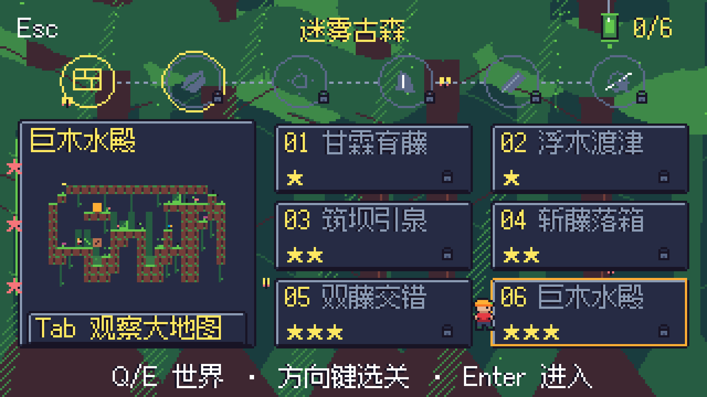
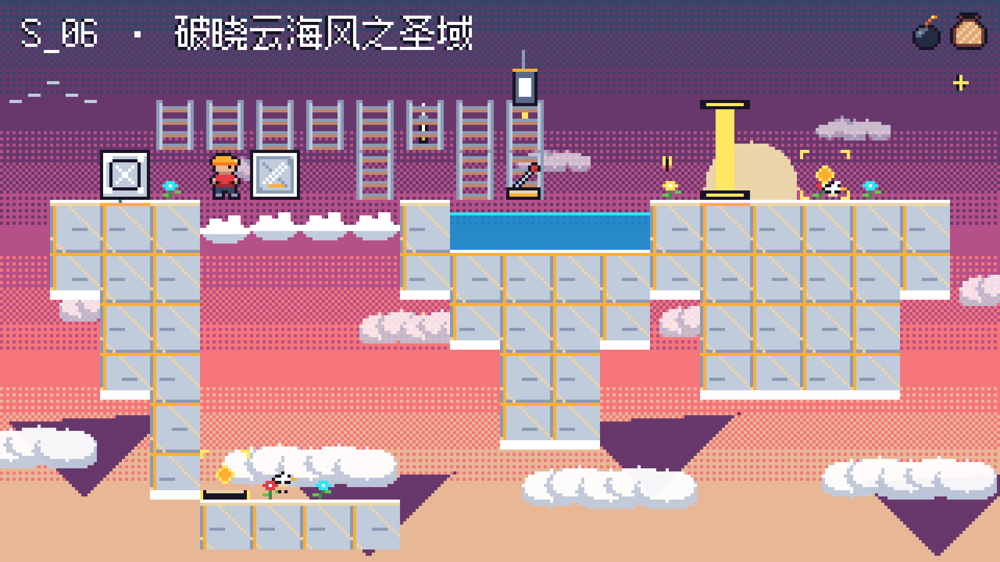

> **最新状态**：以下 full-04 及 DMG 为补修前通过候选。当前补修版 288 项美术专项与 36/36 功能通过，但最终 T8 仍未通过，尚未完成本轮交付；以 docs/v2/status.md 第 16 节为准。

# 美术与 UI 翻新 · 0.4.1 试玩候选

2026-10-15 · 分支 `codex/art-ui-polish` · 基于已封存的第二阶段 A `6af71f0`。

**实现与功能回归完成；补修版最终性能门禁、更新后的包与本地封存尚未完成。用户美术验收、独立技术审核、外部玩家验收及正式版本入库 / 发布尚未进行。**

## 醒来后验收

打开 [实机图册](gallery.html) 或 [macOS 试玩 DMG](../macos-art-ui-polish/Pushbox-art-ui-polish-macos-arm64.dmg)。安装后：大厅 → 闯关模式，Q/E 切六主题；Tab 观察池，F 切换全景 / 原生，原生模式用方向键或拖动平移；大厅 B 查看六张展示大图。

当前无需你操作。最近可执行的一步由**当前 Codex**排查系统资源与性能尖峰，完成补修版全量门禁，通过后重建包并本地封存。此后由用户醒来后在本新 Codex 聊天回复：

```text
美术与 UI 优化验收：通过 / 需改……
```

通过后再由用户组织外部试玩；第二阶段 B、推送 / 合并与正式发布另行启动。当前 Codex 不自动进入这些阶段。

## 本次完成

- 六主题背景改为自然轮廓：分枝树冠与根系 / 斜射光、Bayer 天幕、砂岩柱廊、晶簇溶洞、斜向星云与小行星、地下城拱券。背景缓存生成，小关卡也保留整幅 320×180 景观。
- 六主题挂灯与风车四帧；单格机关原生 16×16，漏斗 16×32、展示天平 64×48 按原大绘制。只有整幅全景 / 实景微缩使用统一缩略；原生观察模式为 1:1。68 张基线精灵保持原字节。
- 独立纯视觉生态层接入局内、观察池、大厅 / 选关：花草、蘑菇、鸟蝶、叶片、藤蔓、树蛙；三速云海、鸟群、云灵 / 云垫；滴水 / 酸、水晶蛾 / 蜗牛、熔岩泡；金沙、圣甲虫 / 壁虎与圣火；星芒、小行星 / 无人机；蝙蝠、鼠与水滴。clock / seed 不写 SDK 或逻辑 key。
- 全部 UI 共享 320×180 画布；航线徽章、银灯笼 / 金冠、主题实景微缩窗、宽松 2×3 图标关卡卡片；观察池有动画循环、全景与平滑原生平移，字体维持 12px。
- 六张展示图和 36 关地貌重塑，共 1,133 个原关卡地形格变更。原机关链、难度与 856 个作者动作保留，全部重新录制 `solution_hashes` / `solution_keys`。S_05 将蓄水装置向内平移一格，保留其内壁并让画布边缘完全悬空。六个天空关卡顶部与左右边缘全为空气，底部无整条实心外框。

## 补修前通过证据（full-04）

- 补修前 [full-04 全量摘要](runs/full-04/logs/test-summary.json)：**25/25** 脚本、零失败；[36 关回放](runs/full-04/campaign-verification.json)：**36/36 won、856 动作、8,929 项** T1/T5/T6/T7 与 UI 检查。
- 机关 **103**、进度 **114**、美术 UI **284**、原美术 **206**、模块 **167**、展示图 **346** 项通过；原 D1–D5 / T01–T04 及作者哈希继续冻结。
- [新 36 关 T8](runs/full-04/performance.json)：**18,840 帧，峰值 3.637 ms，p95 1.096 ms**；硬门槛仍为 4 ms。结算 CPU / SDK upload / BoardView 绘制覆盖，新增背景生态绘制耗时计入 BoardView 指标。
- [总验证与指纹](verification.json)：**17 个冻结文件不变**；full-04 输入指纹另存于该轮目录；当前补修源码不能用该轮冒充通过；阶段 2A 及旧安装包证据保留。C++ 未修改或重编，未运行 prepare_sdk.sh。
- [截图清单](captures/manifest.json)：**82 个真实视图 / 164 张 PNG**，包括全部 36 开局、六主题选关 / 展示全景 / 原生细节 / 观察池及三时刻动画对照；原生 320×180、高清 1920×1080 整数 ×6 逐像素一致。文字边距与底部范围经过字体测量和实机检视。
- [macOS 包报告](../macos-art-ui-polish/README.md)：0.4.1，约 31.0 MiB；包内 **2,877 项**通过，SDK 原字节、签名、DMG 完整性与只读挂载 GUI 启动通过。ad-hoc 测试签名，未 Apple 公证。

## 保留的失败轮

- full-01：25/25 执行，36/36 有解；T8 两帧超限，峰值 10.348 ms，未计通过。
- full-02：25/25 执行，36/36 有解；T8 一帧 4.335 ms，未计通过。
- full-03：教学 T8 6.001 ms，执行到 17/25 后停止，其余 8 项未执行，未计全量通过。
- 早期地图录制中 D_06 的移动后下落通道、S_05 的漏水分别复现并修正；初轮美术专项、灯帧与尺寸缺陷日志均保留在 `logs/initial/`。

full-04 为补修前完整有效通过轮；补修后的 full-05–10 均未通过。最新状态以 [all-attempts.json](all-attempts.json) 与进度文档第 16 节为准。没有拼接定点结果、删除超限样本或放宽阈值。




