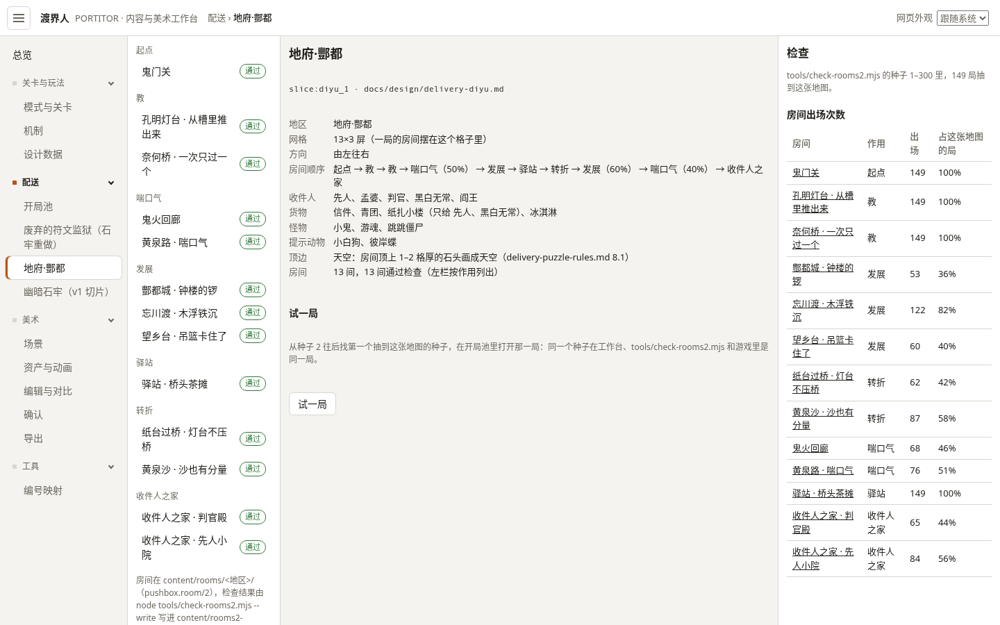

# DLV-03 配送 v2 外观修正：地府顶边、梯顶、配送菜单（工作台）

状态：**已合并**（2026-10-17，Claude 核对：范围在包内，全套检查通过）
基线：`claude/inspiring-ride-zfnn4s` → 分支：`dlv/DLV-03`（**不要**从 `main` 开：`main` 现在还是旧内容）

**开工**（照抄）：
```bash
git fetch origin
git checkout -b dlv/DLV-03 origin/claude/inspiring-ride-zfnn4s
```
**交回**（二选一）：
- 能推送：`git push -u origin dlv/DLV-03`
- 不能推送：`git bundle create DLV-03.bundle origin/claude/inspiring-ride-zfnn4s..dlv/DLV-03`，把 `DLV-03.bundle` 交给用户

只往 `dlv/DLV-03` 提交；不往 `claude/inspiring-ride-zfnn4s`、`main` 或别的分支推送，也不合并别的分支。

会碰的共享文件：`workbench/index.html`、`tools/art.mjs`（只追加）、`workbench/js/app/nav.js`、`tests/workbench.e2e.cjs` 的菜单检查
允许换版本的美术：无（`art.mjs build` 必须 0 bumped）
设计依据：
- [delivery-puzzle-rules.md](../design/delivery-puzzle-rules.md) 第 8 节（顶边、梯顶）
- [art-direction.md](../design/art-direction.md) 第 6 节「顶边画成天空」
- [workbench.md](../design/workbench.md) 第 6.1 节（配送菜单）

## 目标
1. **地府顶边画成天空**：`slices.json` 里写了 `"top_edge": "sky"` 的地图（现在只有 `diyu_1`，设计负责人已经写好），房间顶上 1–2 格厚的石头不画，露出背景。哪些格算天空，严格按第 8.1 节。石牢和其他地图不变。
2. **v2 梯顶**：v2 房间的梯顶和关卡模式一样只画最下面 4 px（第 8.2 节）。现在 `ladder-tops.js` 只包了 v1 的 `PB.droom`，没有包 v2 的 `PB.droom2`；梯顶判断要用同一套代码，不要复制一份。
3. **配送菜单按地图列出**：按第 6.1 节，左侧菜单「配送」下依次是：
   - 开局池
   - 每张 v2 地图各一项，用地图自己的名字，从 `slices.json` 生成
   - 幽暗石牢（v1 切片）
   - 新增地图页 `#rooms2/map/<地图>`；旧网址都还能打开。

## 要读的文件
- AGENTS.md（尤其 0、2、2a 条）、`docs/packages/README.md` 的共同规则
- 上面三份设计文档的对应章节；[LAD-01](LAD-01.md) 的交付
- `workbench/js/core/delivery-scene2.js`（`PB.droom2`，地形和背景在 `draw` 里画）、`workbench/js/core/terrain-diyu.js`、`workbench/js/app/ladder-tops.js`
- `workbench/js/app/nav.js`、`main.js`、`views/rooms2.js`、`views/maps.js`、`index.html`
- `tests/workbench.e2e.cjs`（菜单顺序检查、2e、2f 节）、`tests/rooms2.test.mjs`

## 要产出或修改的文件
- `workbench/js/core/delivery-scene2.js`：天空格的判断与画法、调用梯顶判断。也可以把天空格的判断放进新文件 `workbench/js/core/rooms2-look.js`，在 `index.html` 和 `tools/art.mjs` 的 `loadCore` 里加载。
- `workbench/js/app/ladder-tops.js`：让 `PB.droom2` 也用上梯顶判断。
- `workbench/js/app/nav.js`、`main.js`、`views/rooms2.js`、`index.html`、`css/workbench.css`：配送菜单与地图页。
- 测试：
  - `tests/rooms2.test.mjs` 加天空格判断的单元测试，至少包括 `diyu_naihe`（第 3–9 列连续 3 格要照常画，其余顶上两行是天空）、一间 `dungeon2_*`（没有天空格）、两屏高的 `diyu_fengdu`（第 10–11 行不算）。
  - `tests/workbench.e2e.cjs`：菜单顺序检查改成新菜单；加地图页、旧网址、面包屑的检查。
- 生成文件按共同规则第 2 条重新生成（`node tools/content.mjs build`、`node tools/art.mjs build`）。
- 截图：放在 `docs/packages/DLV-03/`，`diyu_naihe`、`diyu_fengdu`、`diyu_lantern`、`dungeon2_well` 各一张改前、一张改后，外加新菜单一张。

## 不能碰的文件
- AGENTS.md 2a 的冻结区：
  - `art/source/**`、`art/approvals.json`、`art/history/**`、`art/export/approved/**`
  - `workbench/js/core/` 下已有的绘制文件（`terrain.js`、`scene.js`、`sprites.js`、`ui*.js` 等）。`terrain-diyu.js` 也不要改：它参与候选 `theme.diyu` 的内容哈希，改了会换版本。天空格由 `delivery-scene2.js` 决定画不画，地形图案本身不用动
  - `content/i18n/*.json`
- 房间数据 `content/rooms/**`、`content/catalog/**`、`workbench/js/core/rooms2.js`、`mapgen2.js`：这一包不改规则和房间。
- 设计文档：有疑问写进「交付 · 问题」。
- `game/**`

## 验收标准
- 命令（全部通过）：
  - `node tools/content.mjs check` → 0 错误
  - `node tools/check-rooms2.mjs` → 全部通过，结果与改前相同（这一包不改规则）
  - `node tools/art.mjs build` → **0 bumped**，确认记录仍是 6 条
  - `node tools/art.mjs verify` → ok
  - `node --test tests/*.test.mjs`、`node tests/workbench.e2e.cjs` → 全部通过
- 画面：
  - 地府房间顶上不再有一整条石头，露出夜空；连续 3 格以上的石柱照常画。
  - 梯子不再在平台上方多出一截。
  - 石牢顶上照旧。
- 菜单：左侧「配送」下能看到「开局池」「废弃的符文监狱（石牢重做）」「地府·酆都」「幽暗石牢（v1 切片）」；点地图只列这张地图的房间。
- 改动范围只在上面「要产出或修改的文件」里（`git diff --stat` 贴进交付）。

## 交付（制作方填写）

基线：`claude/inspiring-ride-zfnn4s` 的 `07f07f0`（已含 `origin/main`）。冻结区、`terrain-diyu.js`、房间数据、目录、`rooms2.js`、`mapgen2.js`、`views/maps.js`、设计文档、`game/**`、`docs/status.md` 都没改。

### 改动
1. **地府顶边画成天空（8.1）**，`workbench/js/core/delivery-scene2.js`：
   - 新增 `skyCells(v, map)`：只在 `map.top_edge === "sky"` 时有格子。每列从第 0 行往下数连续的实心格（`#` 岩石、`%` 裂石、`R` 硬石；梯子、箱子、浮块、门、出生点、金币都不算），1–2 格是天空，3 格以上整列照常。只数房间最上面这一段，所以两屏高房间的第 10–11 行永远不会算。按开局地图（`v.map`）判断。
   - `scene(M, world, map)` 加了第三个参数（房间所属地图的 `slices.json` 条目），`views/rooms2.js` 传入。天空格在地形图里当空格（开局地形 `mat0` 和每帧地形 `cellsOf`），所以旁边的地形自己收边、下面不长草；天空格放进 `occ`，不放装饰和生态；提示用的蝙蝠不挂在天空格上。逻辑格不变：天空格在谜题里仍是基岩，`check-rooms2` 结果不变。
   - 判断写在 `delivery-scene2.js` 里，没有另开 `rooms2-look.js`，所以 `index.html` 和 `tools/art.mjs` 不用改（`tools/art.mjs` 本来就不加载 `delivery-scene2.js`）。
2. **v2 梯顶（8.2）**：
   - `workbench/js/app/ladder-tops.js` 只加了 `scope(spec, L, s, ox, oy, fn)`：用原来的 `context` / `isTop`（没有复制规则），只是由调用方给出房间左上角在画面上的位置；导出到 `PB.ladderTops.scope`。
   - `delivery-scene2.js` 的 `draw` 把画人物、梯子的那一步放进 `PB.ladderTops.scope(M.spec, L, P.s, ox, oy, …)`。`M.spec` 是开局地图（浮块在里面是 `#`，算落脚处），所以推走浮块、箱子或挖了土，梯顶都不变。没加载 `ladder-tops.js` 时（Node 工具、美术导出）照旧画整段梯子。
   - 首路线（不翻转）的 23 间房里有 41 个梯顶，`diyu_wangxiang`、`dungeon2_well` 没有。
3. **配送菜单按地图列出（workbench.md 6.1）**：
   - `nav.js`：「配送」= 「开局池」`#rooms2/pool` + `{ maps2: "rooms2" }`（按 `slices.json` 里 `format: 2` 的地图逐项生成，名字去掉「配送地图 · 」，顺序同 `slices.json`）+ 「幽暗石牢（v1 切片）」`#maps`。一个页面可以有几项菜单（`href`），每项有 `data-key`；`setCurrent(view, at)` 接受页面给的 `{ key, trail }`：高亮哪一项、面包屑写几段。新增 `PBNav.links()` 列出全部菜单项。以后加地图不用改菜单代码。
   - `main.js`：路由时把页面的 `where(id)`（有就用）传给 `setCurrent`。
   - `views/rooms2.js`：新地图页 `#rooms2/map/<地图>`。左栏只列这张地图的房间，按起点、教、喘口气、发展、驿站、转折、收件人之家分组；中间是简介（地区、网格、方向、房间顺序、收件人、货物、怪物、提示动物、顶边、房间数）和「试一局」；右栏是检查报告里这张地图的房间出场次数。房间页左栏也只列所属地图的房间，加一条「← 地府·酆都 · 地图简介」；开局池页左栏加「地图」一组。`where(id)` 给菜单和面包屑：地图页「配送 › 地府·酆都」，房间页高亮所属地图、面包屑「配送 › 地府·酆都 › 奈何桥」。
   - `css/workbench.css`：一行，让「废弃的符文监狱（石牢重做）」这种长名字在菜单里换行。
   - 旧网址照常打开：`#rooms2`、`#rooms2/pool/<种子>`、`#rooms2/<房间>[/…]`、`#maps…`。
4. **测试**：
   - `tests/rooms2.test.mjs`：「every v2 room draws」改成传所属地图；新增 3 个测试：
     - 天空格判断：`diyu_naihe` 第 3–9 列照常（3 格石柱），顶上两行其余是天空；`diyu_fengdu` 只有第 0 行第 1–27 列；自造的两屏高地图里第 10–11 行的薄石带不算，梯子、门、箱子、浮块不算实心；石牢全部房间、没写 `top_edge` 时都是 0 格。
     - 天空格画法：`diyu_naihe`、`diyu_fengdu`、`diyu_lantern`、`dungeon2_well` 的天空格不画地形、露出背景、没有装饰和生态，逻辑仍是基岩；和石顶比，第 2 行以下的地形一个像素都不变；naihe 的石柱照画；`dungeon2_well` 和改前相同。
     - v2 梯顶：加载 `ladder-tops.js` 前后逐像素比较全部 23 间房：只有 `isTop` 判出的梯顶格的上 12 行变了，每个梯顶都裁了；有作者解的房间走到终点（浮块、箱子已经动过）后裁的还是同一组。
   - `tests/workbench.e2e.cjs`：
     - 第 1 节加两张地图页。
     - 新 2g 节：每张地图页左栏只有本图房间、分组顺序对；地府简介；「试一局」打开本图的一局；从地图页点房间。
     - 6b 节：菜单顺序改成新菜单；一致性检查和逐项点击改按菜单项（`data-key`）；`#maps/5/1` 面包屑改成「配送 › 幽暗石牢（v1 切片）」；新增旧网址检查（8 个网址的菜单高亮和面包屑）。
     - 第 7 节：窄屏加地图页。
5. **截图** `docs/packages/DLV-03/`：房间图用工作台同一套代码画整间房，tick 0，不开叠加层，放大 2 倍。改前是基线代码画的。
   - [diyu_naihe 改前](DLV-03/diyu_naihe-before.png) / [改后](DLV-03/diyu_naihe-after.png)：顶上露出夜空和残月，第 3–9 列的石柱照画，三处梯顶只剩收口。
   - [diyu_fengdu 改前](DLV-03/diyu_fengdu-before.png) / [改后](DLV-03/diyu_fengdu-after.png)：大厅上方第 0 行变成天空，右边山体和第二屏的顶照常。
   - [diyu_lantern 改前](DLV-03/diyu_lantern-before.png) / [改后](DLV-03/diyu_lantern-after.png)：顶上两行整条变成天空。
   - [dungeon2_well 改前](DLV-03/dungeon2_well-before.png) / [改后](DLV-03/dungeon2_well-after.png)：两张逐像素相同（石牢没有天空；这间也没有带落脚处的梯顶）。
   - [新菜单与地府地图页](DLV-03/menu.png)



### git diff --stat
```
 docs/packages/DLV-03.md                       |  78 +++++++++++++-
 docs/packages/DLV-03/diyu_fengdu-after.png    | Bin 0 -> 33972 bytes
 docs/packages/DLV-03/diyu_fengdu-before.png   | Bin 0 -> 34984 bytes
 docs/packages/DLV-03/diyu_lantern-after.png   | Bin 0 -> 8814 bytes
 docs/packages/DLV-03/diyu_lantern-before.png  | Bin 0 -> 10366 bytes
 docs/packages/DLV-03/diyu_naihe-after.png     | Bin 0 -> 9970 bytes
 docs/packages/DLV-03/diyu_naihe-before.png    | Bin 0 -> 10782 bytes
 docs/packages/DLV-03/dungeon2_well-after.png  | Bin 0 -> 14340 bytes
 docs/packages/DLV-03/dungeon2_well-before.png | Bin 0 -> 14340 bytes
 docs/packages/DLV-03/menu.png                 | Bin 0 -> 218311 bytes
 tests/rooms2.test.mjs                         | 117 ++++++++++++++++++++-
 tests/workbench.e2e.cjs                       |  85 ++++++++++++---
 workbench/css/workbench.css                   |   1 +
 workbench/js/app/ladder-tops.js               |  11 +-
 workbench/js/app/main.js                      |   3 +-
 workbench/js/app/nav.js                       |  55 +++++++---
 workbench/js/app/views/rooms2.js              | 145 +++++++++++++++++++++-----
 workbench/js/core/delivery-scene2.js          |  55 +++++++---
 18 files changed, 477 insertions(+), 73 deletions(-)
```

### 命令结果
- `node tools/content.mjs build`：0 错误；生成的 `workbench/data/content.js` 没变。
- `node tools/content.mjs check` → `content: 0 error(s), 0 warning(s); 52 planned levels, 46 with specs; mechanisms playable 27, specified 15, proposed 35; verification report present`
- `node tools/check-rooms2.mjs` → 23 间房全部 ✓，`开局池 delivery_pool：300 个种子 地图 {"dungeon_2":151,"diyu_1":149} 房间数 {"7":35,"8":138,"9":105,"10":22}`；和改前的输出逐行相同。
- `node tools/art.mjs build` → `build ok: 134 assets, 0 bumped, 94 reference renders, 6 approval records`（只改了 `workbench/data/bundle.js` 里的构建时间，没提交）
- `node tools/art.mjs verify` → `verify ok: 134 assets, 6 approval records`
- `node --test tests/*.test.mjs` → `tests 154 / pass 154 / fail 0`（改前 151/151，新增 3 个都在 `rooms2.test.mjs`）
- `node tests/workbench.e2e.cjs` → `all workbench checks passed`，82 项 ok（改前 76 项）

### 交付 · 问题
1. **天空按开局地图判断**：8.1 没写开局还是当前地图，我按开局地图（和 8.2 梯顶一样，画面不会跟着跳）。所以 3 格石柱里的裂石被炸开后，上面两格仍按石柱画（被炸的格照当前地形画成空）；天空格里的裂石被炸开也还是天空。
2. **土、沙不算实心**：8.1 只列了岩石、裂石、硬石。现在只有 `diyu_sand_bridge` 碰到：第 4 列第 2 行是沙，这一列顶上两格画成天空，下面的沙柱照常画。如果土、沙也该算实心，`SKY_SOLID` 加两个字母就行。
3. **墙灯和墙面装饰**：`ambient.js` 的 `wall` 型装饰（石牢火把，墙灯的光也来自它）按屏幕区域的固定高度、固定间距画，不看格子。现在只有石牢主题有，石牢没有天空，所以没影响。以后野外主题加 `wall` 型装饰的话，要在冻结的 `ambient.js` 外面另做避让。地府的蝴蝶在画面里飞或停在实地上，不会停进天空格。
4. **「试一局」**：从当前种子的下一个开始，找第一个抽到这张地图的种子，在开局池打开 `#rooms2/pool/<种子>`（同一个种子在工作台、`check-rooms2` 和游戏里是同一局，网址能分享）。没用「重转」把地图格子直接定成这张图，因为重转在游戏里是有次数的玩法，而且网址里不记重转。如果设计想要不换种子、直接指定地图，请在 6.1 写明。
5. 截图里 `dungeon2_well` 改前改后完全相同，是这间房本身没有要改的地方。石牢的梯顶变化在 `dungeon2_yard`、`dungeon2_bridge` 等房间，测试里逐像素查过。
6. 用户还没看过新画面和菜单，自动测试通过不等于用户认可。
