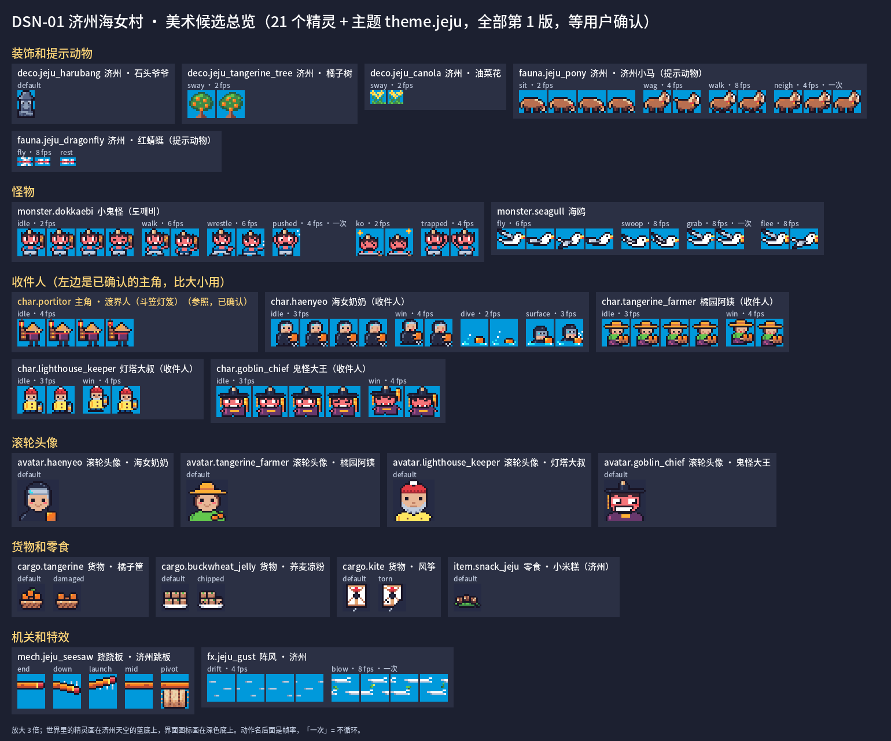
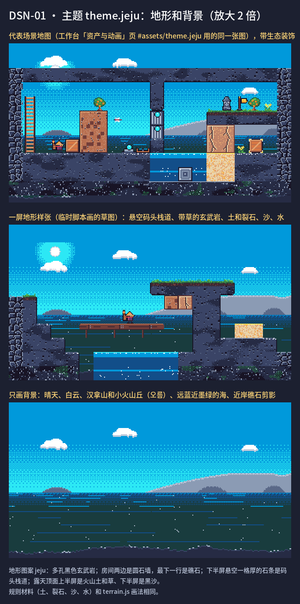
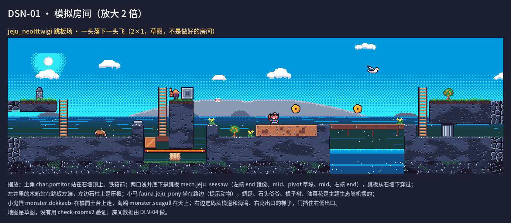

# DSN-01 第三张配送地图「济州海女村」：设计 + 美术候选

状态：**已合并**（2026-10-17，Claude 核对：范围在包内；22 项美术候选第 1 版待用户确认；`art.mjs build` 156 项、0 bumped）
基线：`claude/inspiring-ride-zfnn4s` → 分支：`dsn/DSN-01`（**不要**从 `main` 开：`main` 现在还是旧内容）

**开工**（照抄）：
```bash
git fetch origin
git checkout -b dsn/DSN-01 origin/claude/inspiring-ride-zfnn4s
```
**交回**（二选一）：
- 能推送：`git push -u origin dsn/DSN-01`
- 不能推送：`git bundle create DSN-01.bundle origin/claude/inspiring-ride-zfnn4s..dsn/DSN-01`，把 `DSN-01.bundle` 交给用户

只往 `dsn/DSN-01` 提交；不往 `claude/inspiring-ride-zfnn4s`、`main` 或别的分支推送，也不合并别的分支。

设计依据：
- [delivery-puzzle-rules.md](../design/delivery-puzzle-rules.md)：全文，尤其第 8 节
- [delivery-diyu.md](../design/delivery-diyu.md)、[delivery-dungeon.md](../design/delivery-dungeon.md)：已做完的两张地图，照它们的格式
- [worlds.md](../design/worlds.md) 第 2 节、3.3 节「济州海女村」、第 4 节
- [art-direction.md](../design/art-direction.md)、[art-pipeline.md](../design/art-pipeline.md)

会碰的共享文件：
- `content/catalog/worlds.json`、`slices.json`、`recipients.json`、`cargo.json`、`monsters.json`：只加或改 jeju 的条目
- `workbench/index.html` 脚本列表、`tools/art.mjs` 的 `loadCore`：只追加 `terrain-jeju`
- `docs/packages/README.md` 登记表：只改 DLV-04、DLV-05 两行

允许换版本的美术：无。已有资产一个都不换版本；只新增 jeju 的候选（第 1 版，status `review`）。
预留编号：
- `DLV-04`：济州房间数据
- `DLV-05`：v2 规则支持跷跷板 / 阵风，需要时才用

## 目标
做出配送模式第三张地图「济州海女村」（建议 id `jeju_1`）的**完整设计和全部美术候选**。做完后：
- 用户在工作台「确认」页能看到这张图的所有美术候选，在「场景」页能看到它的地形和背景；
- 房间数据另拆成 DLV-04，交给下一个制作方做。

用户的要求：
1. **明亮**：前两张（石牢、地府）都偏黑暗，这一张是白天的海边：蓝海、晴天、黑色火山石墙、橘子树、海女、码头。
2. **不圈住**：
   - 用 `top_edge: "sky"`；
   - 地形从下往上长（礁石、石墙、码头栈道、橘子园台地），上面大部分是天空；
   - 多用 2×1 的宽房间；
   - 左右和底边逻辑上仍要挡人，但画成海水、礁石、石墙这类自然边界。
3. **专属机制**用已经验证过的跷跷板（`seesaw`）和阵风（`gust`）为主，见关卡 G09、G10、F08、E06；注意阵风只测过一种配置、余量很小。可以配合已有的水、浮箱、推箱、梯子；不发明需要新物理的机制。
4. 配送 v2 的规则全部照用：先教后用、每间房只教或只用一件事、怪物不进解谜区、必需机制、不靠摔、提示和解法一致。

## 第一步：设计
1. 新文档 `docs/design/delivery-jeju.md`，按 `delivery-diyu.md` 的结构写：
   - **主题与画风**：明亮海边的画面、配色、地形图案、背景、装饰；写清和石牢、地府怎么区分。按 worlds.md 2.1 节写清取材出处和注意事项：石头爷爷只作地标，不能推倒；小鬼怪（도깨비）要可爱，不吓人。
   - **收件人**（4–5 位，必须有海女奶奶）和**货物**（3–4 种）：稀有度、规则、喜欢什么、住在哪间收件人之家；`cargo_only` 写清楚。
   - **怪物**（2–3 种，建议小鬼怪：拦路摔跤，推出两格算赢；海鸥：抢东西）：行为、怎么对付（能不能推、压、困）、出现在哪。
   - **房间表**（10–13 间）：
     - 每间写名字、角色、大小、关键想法 → 变化、needs / teaches / requires、怪物、出入口方向；
     - 写定 `layout.sequence` 和地图方向。
   - **提示动物**：一只地上走的主动物（收零食）+ 一只会飞的（只带路），以及零食在这张图的包装。不能和怪物或随机生态混淆。
   - **美术清单**：第二步要画的全部候选（编号、尺寸、动作列表）。
   - **待定问题**：每个给 2–3 个选项和好坏，并写明这次先按哪个做。
2. `docs/design/delivery-puzzle-rules.md` 第 8 节加 **8.3「野外地图怎么做房间」**：地形从下往上长、顶上留天空、边界画成自然物、多用宽房间。写成森林、云端等以后的野外地图都能照用的通用规则。
3. 设计目录：
   - `worlds.json` 的 `jeju`：补齐 `theme`、`hint_fauna`、`ambient_exclude`、`status`，字段照 `diyu` 的写法；
   - `slices.json`：加 `jeju_1`（照 `diyu_1` 的字段，`top_edge: "sky"`），`rooms2` 写计划中的房间 id；
   - `recipients.json`、`cargo.json`、`monsters.json`：加新条目；
   - **不要**把 `jeju_1` 加进开局池 `delivery_pool`：房间还没做，加了会生成失败。这一步留给 DLV-04。
4. 写工作包：
   - `docs/packages/DLV-04.md`（济州房间数据）：照 README 模板，写清每间房的要求、`check-rooms2` 全部通过，最后把 `jeju_1` 加进开局池；
   - 如果 v2 回合规则（`workbench/js/core/rooms2.js`、`tilemodel.js`）还不支持跷跷板或阵风，再写 `DLV-05.md`：要达到的行为和验收条件。不需要就不写；
   - README 登记表里把这两行改成「待派」。
5. 世界名、角色名等写在设计目录里，照 `diyu` 的写法；**不改** `content/i18n/*.json`。如果确实需要新的界面文字，放新表 `content/i18n-jeju/`，缺的字形用 `python3 tools/build-font.py --ext jeju` 生成。

## 第二步：美术候选（按第一步的美术清单）
1. **主题 `theme.jeju`**：照 `theme.diyu` 和 `workbench/js/core/terrain-diyu.js` 的做法，新建 `workbench/js/core/terrain-jeju.js`，只接管 jeju 自己的地形图案和背景。
   - 地形：黑色玄武岩（多孔、圆石垒墙）、沙滩、码头木板、橘子园土台；
   - 背景：白天的海和天空，远处汉拿山，有云，海面有闪光；
   - **规则材料**（土、裂石、沙、水）的画法必须和 `terrain.js` 一样，可读性优先（art-direction 第 8 节）；
   - 在 `workbench/index.html`（`terrain-diyu.js` 后面）和 `tools/art.mjs` 的 `loadCore`（`terrain-diyu` 后面）**追加**加载。
2. **其他候选**：在 `art/source/<类别>/` 新建源文件，格式见 art-pipeline 第 2 节，照 `deco.diyu_lantern`、`char.meng_po`、`avatar.meng_po`、`monster.jiangshi`、`fauna.diyu_dog`、`cargo.qingtuan` 的写法，全部 status `review`：
   - 装饰（石头爷爷、橘子树等）；
   - 提示动物两只；
   - 怪物（含动作）；
   - 收件人角色与滚轮头像；
   - 货物（含损坏状态）；
   - 跷跷板 / 阵风在这张图里的外观（如果和关卡模式的不同）。
3. **规格**：调色、尺寸、动作按 art-direction。明亮但不刺眼；角色 Q 版；和已确认的主角 `char.portitor` 放在一起不突兀。
4. **对照图**：放在 `docs/packages/DSN-01/`：
   - 全部候选一张总览；
   - 主题地形和背景一张；
   - 一张"模拟房间"：用一间设计中的房间草图，摆上地形、角色、怪物、提示动物，看整体效果。可以用工作台「场景」页截图，或者用临时脚本出图，脚本不提交。

## 可改的文件
- 新建：
  - `docs/design/delivery-jeju.md`
  - `docs/packages/DLV-04.md`、`docs/packages/DLV-05.md`（需要时）、`docs/packages/DSN-01/**`（对照图）
  - `art/source/**/` 下 jeju 的新源文件（只新建，不改已有的）
  - `workbench/js/core/terrain-jeju.js`
  - `content/i18n-jeju/**`、`workbench/js/core/font-jeju.js`（需要时）
- 修改：
  - `docs/design/delivery-puzzle-rules.md`（只加 8.3）、`docs/design/worlds.md`（只改济州那段和地区表那一行）、`docs/design/art-direction.md`（只加济州主题一条）
  - `content/catalog/` 下上面列出的 5 个文件（只动 jeju 的条目）
  - `workbench/index.html`、`tools/art.mjs`（只追加加载 `terrain-jeju`，需要时加 `font-jeju`）
  - `docs/packages/README.md`（只改 DLV-04、DLV-05 两行）、本文件的状态和「交付」
- 生成文件：用工具重新生成后提交，不手改。

## 不能碰的文件
- AGENTS.md 2a 冻结区里已有的一切：
  - 已有的 `art/source/**`、`art/approvals.json`、`art/history/**`、`art/export/approved/**`
  - 已有的 `workbench/js/core/` 绘制文件，**包括 `terrain-diyu.js`**
  - `content/i18n/*.json`
- 石牢、地府的设计和数据；房间数据 `content/rooms/**`（留给 DLV-04）
- `rooms2.js`、`mapgen2.js`、`tilemodel.js`、`delivery-scene2.js`
- `docs/status.md`
- `game/**`
- **不能自己批准美术**，也不能把"测试通过"当作确认。

## 验收标准
- [process.md](../process.md) 第 6 节全套检查通过，其中：
  - `node tools/content.mjs check` → 0 错误；
  - `node tools/art.mjs build` → **0 bumped**，只有新增的 jeju 候选，确认记录仍是 6 条；
  - `node tools/art.mjs verify` → ok。
- 工作台：
  - 「确认」页能看到全部 jeju 候选；
  - 「资产与动画」页每个候选的动作都能播放；
  - 「场景」页能选 `theme.jeju` 看到地形和背景。
- 设计文档五部分齐全；DLV-04 包写好并在 README 登记。
- 交付里写出给用户确认用的命令（版本号以 build 结果为准）：
  `node tools/art.mjs approve --items <id@1,...> --by 用户 --via chat --scope "济州海女村美术" --note "<用户原话>"`

## 交付（制作方填写）

### 分支、提交、交回方式
- 分支 `dsn/DSN-01`，从 `origin/claude/inspiring-ride-zfnn4s`（`58e823b`）开，没有合并别的分支。
- 两个提交：`8fe48d2`（设计文档、规则 8.3、worlds.md / art-direction.md、DLV-04 / DLV-05 两个包、README 两行）+ 本提交（设计目录、22 项美术候选、`terrain-jeju.js`、对照图、生成文件、本「交付」）。最后提交号写在交回的对话里，也可以 `git log -1 dsn/DSN-01` 查看。
- 交回：没有推送权限，用 Git bundle `DSN-01.bundle`（`git bundle create DSN-01.bundle origin/claude/inspiring-ride-zfnn4s..dsn/DSN-01`，已经 `git bundle verify`）。
- 导入：`git bundle verify DSN-01.bundle`，再 `git fetch DSN-01.bundle dsn/DSN-01:dsn/DSN-01`。

### 改了哪些文件
- 设计：
  - `docs/design/delivery-jeju.md`（新）：照 `delivery-diyu.md` 的结构，共 7 节：
    - 主题与画风：取材出处，石头爷爷只作地标，小鬼怪要可爱；
    - 4 位收件人、4 种货物，含 `cargo_only`；
    - 2 种怪物；
    - 13 间房的房间表，含 `layout.sequence` 和地图方向；
    - 提示动物：济州小马、红蜻蜓，零食包装是小米糕；
    - 22 项美术清单；
    - 13 个待定问题，每个都写了这次按哪个做。
  - `docs/design/delivery-puzzle-rules.md`：只加 8.3「野外地图怎么做房间」。
  - `docs/design/worlds.md`：只改 3.3 济州那段和地区表那一行。
  - `docs/design/art-direction.md`：只加济州主题一条。
- 工作包：
  - 新写 `docs/packages/DLV-04.md`（济州 13 间房，做完把 `jeju_1` 加进开局池）和 `docs/packages/DLV-05.md`（v2 回合规则支持跷跷板 / 阵风）；
  - `docs/packages/README.md` 只把这两行改成「待派」；
  - 本文件只改状态和「交付」。
- 设计目录（只动 jeju 的条目）：
  - `worlds.json` 的 `jeju`：补 `theme`、`hint_fauna`、`ambient_exclude`、`status`，写法照 `diyu`；
  - `slices.json`：`jeju_1` 放在顶层的 `planned` 里（`top_edge: "sky"`，`rooms2` 写了 13 间计划中的房），**没进** `entries`，也没进开局池 `delivery_pool`（见问题 2）；
  - `recipients.json`：补齐已有的海女奶奶、鬼怪大王，新增橘园阿姨、灯塔大叔；
  - `cargo.json`：新增橘子筐、风筝；荞麦凉粉改了规则、补了数值（这条本来只有济州用：只有鬼怪大王喜欢它）；
  - `monsters.json`：补齐已有的小鬼怪 `dokkaebi`、海鸥 `seagull`。
- 美术源：`art/source/` 下新建 22 项，全部第 1 版、status `review`：
  - 主题：`theme.jeju`；
  - 装饰：`deco.jeju_harubang`（石头爷爷）、`deco.jeju_tangerine_tree`、`deco.jeju_canola`；
  - 提示动物：`fauna.jeju_pony`（济州小马）、`fauna.jeju_dragonfly`（红蜻蜓）；
  - 怪物：`monster.dokkaebi`、`monster.seagull`；
  - 收件人：`char.haenyeo`、`char.tangerine_farmer`、`char.lighthouse_keeper`、`char.goblin_chief`，以及同名的 `avatar.*` 滚轮头像；
  - 货物：`cargo.tangerine`、`cargo.buckwheat_jelly`、`cargo.kite`，都有损坏状态；
  - 零食：`item.snack_jeju`（小米糕）；
  - 机关和特效：`mech.jeju_seesaw`（济州跳板）、`fx.jeju_gust`。
- 地形：
  - `workbench/js/core/terrain-jeju.js`（新）：照 `terrain-diyu.js` 的做法，只接管图案 `jeju` 的地形和背景 `jeju`；土、裂石、沙、水照用 `terrain.js` 的画法，连描边一起。
  - `workbench/index.html`（`terrain-diyu.js` 后面）和 `tools/art.mjs` 的 `loadCore`（`terrain-diyu` 后面）各追加一行。
- 对照图：`docs/packages/DSN-01/candidates.png`、`theme-jeju.png`、`room-neolttwigi.png`，用临时脚本出图，脚本没提交。
- 生成文件：用 `node tools/art.mjs build` 重新生成，没有手改：
  - `art/export/manifest.json`、`art/export/preview/` 下 22 张新预览；
  - `content/export/content-manifest.json`、`content/export/id-map.json`；
  - `workbench/data/bundle.js`、`workbench/data/content.js`。
- 没碰：
  - 已有的 `art/source/**`、`art/approvals.json`、`art/history/**`、`art/export/approved/**`；
  - 已有的 `workbench/js/core/` 绘制文件，包括 `terrain-diyu.js`；
  - `content/i18n*/**`（没有新文字表，也不用新字形）、`content/rooms/**`；
  - `rooms2.js`、`mapgen2.js`、`tilemodel.js`、`delivery-scene2.js`；
  - `docs/status.md`、`game/**`、`tests/**`。

### 跑了哪些命令和结果（2026-10-17，Linux 沙箱，在本提交的文件上跑）
- `node tools/content.mjs check` → `0 error(s), 0 warning(s)`，text layout 0 issue(s)
- `node tools/check-levels.mjs` → 46 关全部 ok
- `node tools/check-rooms.mjs` → 通过（`dungeon_1` 300 个种子）
- `node tools/check-rooms2.mjs` → 23 间房和开局池全部通过（开局池仍是 `dungeon_2`、`diyu_1`），`rooms2-check.generated.json` 没变
- `node tools/art.mjs build` → `build ok: 156 assets, 0 bumped, 94 reference renders, 6 approval records`：
  - 基线 134 项 + 新候选 22 项；
  - 没有换版本，确认记录仍是 6 条，94 张参考图一张没变。
- `node tools/art.mjs verify` → `verify ok: 156 assets, 6 approval records`
- `node --test tests/*.test.mjs` → 151 通过、0 失败
- `node tests/workbench.e2e.cjs` → `all workbench checks passed`（76 项）
  - 沙箱里 Playwright 找不到自带浏览器，加了 `PLAYWRIGHT_CHROMIUM_EXECUTABLE=/usr/local/bin/chromium`。
- 没改测试。

工作台另外用临时脚本（Playwright，没提交）逐项看过：
- 「确认」页：22 项 jeju 候选全部列出，都是第 1 版、待确认、能勾选；
- 「资产与动画」页：
  - 21 个精灵的 47 个动作逐个播放，画面都在变；
  - `#assets/theme.jeju` 画出代表场景（地形 + 背景）；
- 没有页面报错；
- 「场景」页选不到 `theme.jeju`（见问题 1）。

又在临时副本里把 `jeju_1` 移进 `entries` 跑 `node tools/content.mjs check`：
- 27 个错误，全是房间还没做：13 间房不存在、10 个房间角色没有房、4 位收件人没有家；
- 没有别的错。DLV-04 做完房间后应该归零。

### `git diff --stat origin/claude/inspiring-ride-zfnn4s..dsn/DSN-01`
```text
 art/export/manifest.json                         | 1325 ++++++++++++++++++++--
 art/export/preview/avatar.goblin_chief.png       |  Bin 0 -> 288 bytes
 art/export/preview/avatar.haenyeo.png            |  Bin 0 -> 275 bytes
 art/export/preview/avatar.lighthouse_keeper.png  |  Bin 0 -> 261 bytes
 art/export/preview/avatar.tangerine_farmer.png   |  Bin 0 -> 271 bytes
 art/export/preview/cargo.buckwheat_jelly.png     |  Bin 0 -> 221 bytes
 art/export/preview/cargo.kite.png                |  Bin 0 -> 255 bytes
 art/export/preview/cargo.tangerine.png           |  Bin 0 -> 230 bytes
 art/export/preview/char.goblin_chief.png         |  Bin 0 -> 471 bytes
 art/export/preview/char.haenyeo.png              |  Bin 0 -> 555 bytes
 art/export/preview/char.lighthouse_keeper.png    |  Bin 0 -> 387 bytes
 art/export/preview/char.tangerine_farmer.png     |  Bin 0 -> 352 bytes
 art/export/preview/deco.jeju_canola.png          |  Bin 0 -> 148 bytes
 art/export/preview/deco.jeju_harubang.png        |  Bin 0 -> 194 bytes
 art/export/preview/deco.jeju_tangerine_tree.png  |  Bin 0 -> 242 bytes
 art/export/preview/fauna.jeju_dragonfly.png      |  Bin 0 -> 126 bytes
 art/export/preview/fauna.jeju_pony.png           |  Bin 0 -> 422 bytes
 art/export/preview/fx.jeju_gust.png              |  Bin 0 -> 269 bytes
 art/export/preview/item.snack_jeju.png           |  Bin 0 -> 175 bytes
 art/export/preview/mech.jeju_seesaw.png          |  Bin 0 -> 456 bytes
 art/export/preview/monster.dokkaebi.png          |  Bin 0 -> 753 bytes
 art/export/preview/monster.seagull.png           |  Bin 0 -> 437 bytes
 art/export/preview/theme.jeju.png                |  Bin 0 -> 10604 bytes
 art/source/avatar/avatar.goblin_chief.json       |   59 +
 art/source/avatar/avatar.haenyeo.json            |   59 +
 art/source/avatar/avatar.lighthouse_keeper.json  |   59 +
 art/source/avatar/avatar.tangerine_farmer.json   |   59 +
 art/source/cargo/cargo.buckwheat_jelly.json      |   76 ++
 art/source/cargo/cargo.kite.json                 |   76 ++
 art/source/cargo/cargo.tangerine.json            |   76 ++
 art/source/character/char.goblin_chief.json      |  124 ++
 art/source/character/char.haenyeo.json           |  204 ++++
 art/source/character/char.lighthouse_keeper.json |  114 ++
 art/source/character/char.tangerine_farmer.json  |  116 ++
 art/source/deco/deco.jeju_canola.json            |   54 +
 art/source/deco/deco.jeju_harubang.json          |   51 +
 art/source/deco/deco.jeju_tangerine_tree.json    |   70 ++
 art/source/fauna/fauna.jeju_dragonfly.json       |   62 +
 art/source/fauna/fauna.jeju_pony.json            |  166 +++
 art/source/fx/fx.jeju_gust.json                  |  190 ++++
 art/source/item/item.snack_jeju.json             |   51 +
 art/source/mechanism/mech.jeju_seesaw.json       |  171 +++
 art/source/monster/monster.dokkaebi.json         |  273 +++++
 art/source/monster/monster.seagull.json          |  186 +++
 art/source/theme/theme.jeju.json                 |  197 ++++
 content/catalog/cargo.json                       |   47 +-
 content/catalog/monsters.json                    |   34 +-
 content/catalog/recipients.json                  |   64 +-
 content/catalog/slices.json                      |  160 +++
 content/catalog/worlds.json                      |   34 +-
 content/export/content-manifest.json             |  179 ++-
 content/export/id-map.json                       |  302 ++++-
 docs/design/art-direction.md                     |    1 +
 docs/design/delivery-jeju.md                     |  191 ++++
 docs/design/delivery-puzzle-rules.md             |   13 +
 docs/design/worlds.md                            |    4 +-
 docs/packages/DLV-04.md                          |   96 ++
 docs/packages/DLV-05.md                          |   85 ++
 docs/packages/DSN-01.md                          |  208 +++-
 docs/packages/DSN-01/candidates.png              |  Bin 0 -> 178100 bytes
 docs/packages/DSN-01/room-neolttwigi.png         |  Bin 0 -> 96950 bytes
 docs/packages/DSN-01/theme-jeju.png              |  Bin 0 -> 108570 bytes
 docs/packages/README.md                          |    4 +-
 tools/art.mjs                                    |    2 +-
 workbench/data/bundle.js                         |    2 +-
 workbench/data/content.js                        |    2 +-
 workbench/index.html                             |    1 +
 workbench/js/core/terrain-jeju.js                |  305 +++++
 68 files changed, 5423 insertions(+), 129 deletions(-)
```

### 对照图
全部候选总览，放大 3 倍。左边是已确认的主角 `char.portitor`，比大小用：



主题地形和背景，放大 2 倍。从上到下：
- 代表场景地图（和 `#assets/theme.jeju` 是同一张）；
- 一屏地形样张；
- 只画背景。



模拟房间 `jeju_neolttwigi` 跳板场：2×1 的草图，没有用 `check-rooms2` 验证；房间数据由 DLV-04 做。



### 给用户确认用的命令
22 项都是第 1 版（以本次 build 为准）。用户看过以后，`--items` 里只放用户认可的项：
```bash
node tools/art.mjs approve --items theme.jeju@v1,deco.jeju_harubang@v1,deco.jeju_tangerine_tree@v1,deco.jeju_canola@v1,fauna.jeju_pony@v1,fauna.jeju_dragonfly@v1,monster.dokkaebi@v1,monster.seagull@v1,char.haenyeo@v1,char.tangerine_farmer@v1,char.lighthouse_keeper@v1,char.goblin_chief@v1,avatar.haenyeo@v1,avatar.tangerine_farmer@v1,avatar.lighthouse_keeper@v1,avatar.goblin_chief@v1,cargo.tangerine@v1,cargo.buckwheat_jelly@v1,cargo.kite@v1,item.snack_jeju@v1,mech.jeju_seesaw@v1,fx.jeju_gust@v1 --by 用户 --via chat --scope "济州海女村美术" --note "<用户原话>"
```
也可以在工作台「确认」页勾选、导出请求文件，再用 `--from-file`（见 art-pipeline.md）。本包没有自己批准任何美术。

### 交付 · 问题
1. **验收「场景页能选 `theme.jeju`」没做到**：
   - `workbench/js/app/views/scenes.js` 只列 `scene.js` 写死的六个主题，地府也不在；要改 `scenes.js`，不在本包可改范围。
   - 现在先在「资产与动画」页 `#assets/theme.jeju` 和对照图里看。
   - 建议 Claude 合并时做，或者 DLV-05 第 5 条顺手做（设计文档待定 5）。
2. **`jeju_1` 在 `slices.json` 顶层的 `planned` 里**，不在 `entries`：
   - 放进 `entries` 会因为房间没做报 27 个错（见上）；
   - DLV-04 做完房间后移进 `entries`，再进开局池（待定 4，按 A）。
3. **红蜻蜓的 `fed` 台词交给 DLV-04**：
   - `tests/rooms2.test.mjs` 要求 `worlds.json` 里提示动物的 `fed` 和 `content/i18n-rooms2` 里的 `dlg.fauna.<id>.fed` 一字不差；本包不能改文字表，所以先不写。
   - DLV-04 包和 README 登记表已经写明。意思是「只帮小马带路，喂零食要找小马」。
4. **跷跷板和阵风的美术**：
   - `mech.jeju_seesaw` 是 16 × 20：下面 16 行是格子，上面 4 行留给翘起的端头，比别的格子高。
   - 两项都没有登记进 `mechanisms.json`（不在可改范围）。给不给关卡模式用，等用户定（待定 12）。
5. **v2 画面要等 DLV-05**：`BANDED` 加 `jeju`（多屏房间的背景按屏行重复）、零食图标、跷跷板和阵风的画法都在 `delivery-scene2.js`，本包不能改，DLV-05 包里写了。
6. **亮天空请用户看图定**：
   - 和 art-direction 第 1 节第 5 条（背景不比地形的中间调亮）有冲突，这次按待定 1 的 C：天空亮，靠近地形的海和近岸压暗；
   - 背景的海远处蓝、近处墨绿，和规则的水分开（待定 2，按 A）。
7. **新规则还没实现**：
   - `bounce_damage`、`gust_damage` 这些新数值；
   - 摔跤、海女上岸、海鸥俯冲这些实时规则。
   - 都留给 DLV-01 之后（待定 11）；v2 里先当普通的收件人和怪物。
8. **美术里多出来的两样**：
   - `monster.dokkaebi` 多一个 `trapped`（被困）动作；
   - 零食单独做了 `item.snack_jeju`，因为已确认的 `item.snack` 不能加动作。
9. **合并提醒**：`workbench/index.html` 和 `tools/art.mjs` 追加的那一行可能和 DLV-03 的改动挨着，合并时两边的行都要留下。
10. **ART-01 预留号没用**：美术候选在本包里做完了。README 那一行本包不能改，可以收回。
11. **名字等用户定**：世界名「济州海女村」、房名、角色名是按意译起的（待定 13）。
12. **模拟房间只是草图**：没有用 `check-rooms2` 验证过，真正的房间由 DLV-04 做。
13. **生成文件每次都会变**：`workbench/data/bundle.js` 的构建时间、`workbench/data/content.js` 的 `ms` 字段每次 build 都会变，和内容无关。
