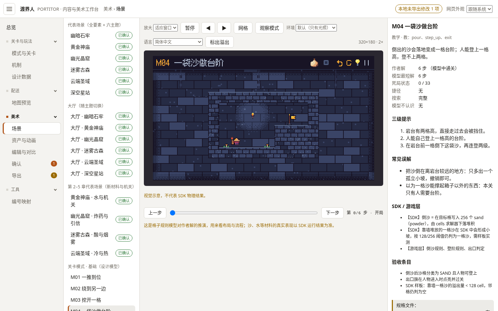
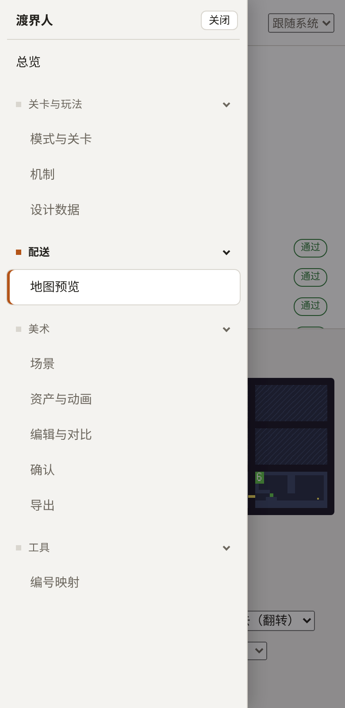

# WB-01 工作台改成左侧分类菜单（可折叠）

状态：已完成（2026-10-16；用户 2026-10-16 要求，排在 UI-05 和配送改造的工作台页面之前。菜单已换好，之后加页面在 `workbench/js/app/nav.js` 的 `MENU` 里加一行即可接入菜单和路由）
分支：`claude/inspiring-ride-zfnn4s`（三条线已经合在这里），做完推回同一分支

## 目标
现在 11 个页面横排在顶部，以后机制、界面、配送页面还会越来越多，放不下。改成**左侧竖排菜单，按分类折叠**；页面内容本身不改。

## 菜单分类（第一版）

| 分类 | 子页面（现有 `data-view`） |
|---|---|
| 总览 | `overview` |
| 关卡与玩法 | `modes` 模式与关卡、`mechanisms` 机制、`catalog` 设计数据 |
| 配送 | `maps` 地图预览（配送改造的新页面以后加在这里） |
| 美术 | `scenes` 场景、`assets` 资产与动画、`edit` 编辑与对比、`review` 确认（保留待确认数量）、`export` 导出（保留草稿提示） |
| 工具 | `ids` 编号映射 |

以后加页面、加分类，只改一份菜单列表（写在 JS 里的一个数组），不用改别处。界面线的「界面风格」页、配送的「抽奖转轮」等以后各自加进对应分类。

## 要求
- 分类标题点一下展开 / 收起；当前页面所在的分类自动展开并高亮当前项；展开状态记在浏览器里（`localStorage`，读写失败也能正常用）。
- 地址不变：`#maps/5/1`、`#assets/char.miner` 这类链接照常能打开，前进 / 后退照常。
- 窄屏（手机宽度）：菜单收成左上角一个按钮，点开是抽屉；页面不能出现横向滚动条（现有 e2e 检查 390px 宽）。
- 左栏可以整体收起，给地图预览、场景这类大画面腾地方。
- 保持现有配色和像素字体风格；双击打开 `workbench/index.html` 仍然不需要安装任何东西。

## 要读的文件
- `workbench/index.html`、`workbench/css/workbench.css`、`workbench/js/app/main.js`、`workbench/js/app/views/`
- `tests/workbench.e2e.cjs`（它按菜单点页面，改完要跟着改）

## 不能碰的文件
- AGENTS.md 2a 冻结区：`workbench/js/core/` 下的绘制文件、`art/**`、`content/i18n/*.json`
- 各页面的内容和画法（这个包只换菜单和外框）

## 验收标准
- `node tests/workbench.e2e.cjs` 全部通过（按新菜单改测试，原有每一项检查都保留）
- `node tools/art.mjs build` → 0 bumped；`node tools/art.mjs verify` ok；`node tools/content.mjs check` 0 error；`node --test tests/*.test.mjs` 全部通过
- 「交付」里放两张截图：宽屏菜单展开、窄屏抽屉打开

## 交付（制作方填写）

### 改了哪些文件
- `workbench/js/app/nav.js`（新）：`MENU` 数组是唯一一份页面清单，左侧菜单按它画，`main.js` 的路由也从它生成（`PBNav.pages()`）。加页面：在对应分类的 `items` 里加 `{ view, label, module }`，再加该页自己的 `<section id="view-…">` 和页面脚本；加分类：加一项 `{ group, label, items }`。分类折叠、左栏整体收起、窄屏抽屉、顶栏「分类 › 页面」位置提示也在这里。
- `workbench/index.html`：去掉顶部横排标签；顶栏改为「菜单按钮 · 渡界人 · 分类 › 页面 · 草稿提示 · 网页外观」；加左侧 `<nav id="nav">` 和抽屉遮罩。各页 `<section>` 内容没动。
- `workbench/js/app/main.js`：页面表改为读 `PBNav.pages()`；高亮当前项、两个数字改由 `PBNav` 显示；抽屉打开时编辑器不接收快捷键。页面切换和地址解析逻辑没改。
- `workbench/css/workbench.css`：外框改为「顶栏 + 左栏 + 内容」网格；删掉旧标签样式；加菜单、收起、窄屏抽屉样式。只用已有颜色变量和字体（外框原本就是系统字体，像素字体用于画面和标识，没改）。
- `tests/workbench.e2e.cjs`：原有 47 项检查原样保留（它们本来就用地址打开页面，没有依赖旧标签），新增 19 项菜单检查。
- 截图：`docs/packages/WB-01/wide-menu.png`、`docs/packages/WB-01/narrow-drawer.png`。
- 没碰：`workbench/js/core/**`、`art/**`、`content/i18n/*.json`、各页面内容和画法、`docs/status.md`。

### 做出来的效果
- 菜单：总览（直接链接，不做成分类）、关卡与玩法、配送、美术、工具，子页面同上表。
- 分类标题点一下展开 / 收起，默认全部展开。打开某页时它所在的分类自动展开，当前项高亮（白底 + 左侧强调色竖条），所在分类标题也高亮；在同一页里手动收起当前分类，会保持收起。展开状态存在 `localStorage`（`pb.wb.nav.v1`），读写失败时按默认展开照常使用。
- 「确认」后的数字 = 已勾选待确认的项数（和原来标签上的数字同义）；「导出」后的数字 = 本地未导出修改项数，顶栏右侧「本地未导出修改 n 项」提示保留。分类收起时，如果里面有数字，分类标题旁显示一个小点。
- 左上角按钮：宽屏时整列收起 / 展开（记住状态，画面区域随之变宽）；720px 及以下打开抽屉（遮罩 + 「关闭」按钮；Esc、点遮罩、选页面都会关闭，焦点回到按钮；抽屉打开时后面的页面不可操作）。390px、320px 宽都没有横向滚动条。
- 地址、前进 / 后退照旧（`#maps/5/1`、`#assets/char.miner` 已测）；双击打开 `workbench/index.html` 照旧，没有新依赖。

### 跑了哪些命令和结果（2026-10-16，Linux 沙箱）
- `node tests/workbench.e2e.cjs` → 66/66 通过（原 47 + 新 19）
- `node tools/art.mjs build` → `build ok: 133 assets, 0 bumped, 92 reference renders, 6 approval records`
- `node tools/art.mjs verify` → `verify ok: 133 assets, 6 approval records`
- `node tools/content.mjs check` → 0 error(s)、0 warning(s)
- `node --test tests/*.test.mjs` → 141 通过、0 失败

新增的 19 项 e2e：菜单顺序和分类；菜单链接、路由都来自同一份列表并覆盖每个页面；逐项点击打开对应页面且只有一项高亮；`#maps/5/1`、`#assets/char.miner` 直接打开；前进 / 后退；折叠状态刷新后保留；打开页面会展开所在分类；当前分类可收起且在页内保持收起；确认数字和收起分类的小点；导出草稿数字出现与清除（2 项）；整列收起后内容变宽、刷新后保留、可再展开；无控制台报错；禁用 `localStorage` 时照常使用；390px 宽：按钮在左上且抽屉默认关闭、打开后无横向滚动且后面不可操作、选页面后关闭、Esc 和点外面关闭。

### 截图
宽屏（1440×900，`#scenes/level.M04`）：菜单全部展开，当前「美术 › 场景」高亮。为展示保留的两个数字，截图前在浏览器里做了 1 项本地修改、勾选了 1 项待确认（只在截图用的浏览器里，没有写进仓库）。

窄屏（390×800，`#maps/5/1`）：抽屉打开，当前「配送 › 地图预览」高亮。

### 交付 · 问题
- 没有需要设计负责人或用户决定的事。
- `node tools/art.mjs build` 每次都会改写 `workbench/data/bundle.js`（只有构建时间）和 `workbench/data/content.js`（只有房间路线检查的耗时 `ms` 字段），内容没变，没有提交。
- 沙箱里 Playwright 找不到自带浏览器，跑 e2e 时加了 `PLAYWRIGHT_CHROMIUM_EXECUTABLE=/usr/local/bin/chromium`（测试脚本原本就支持）；正常装好 Playwright 的电脑直接 `node tests/workbench.e2e.cjs`。
- 按本次约定没有直接推送：提交以 Git bundle 交给用户，由用户推回 `claude/inspiring-ride-zfnn4s`。
